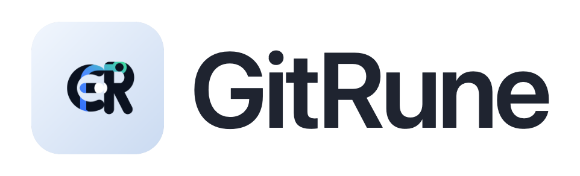

<p align="center">
  
</p>

<p align="center">
  A Git client with GitHub pull requests, built on an IntelliJ-style workbench.
</p>

<p align="center">
  Rust core · Tauri 2 · Apache 2.0
</p>

---

## What this is

GitRune is a focused Git client. It keeps the parts of a JetBrains-style workbench that a
version-control workflow needs — the commit tool window, the log with its commit graph,
shelves, changelists, worktrees, the diff and merge editors — and drops the code-development
surface (language servers, debugger, run configurations, database tools, plugins).

The Git engine is the original `ide-vcs` crate unchanged: 81 IPC commands driving `gitoxide`
for reads and the `git` executable for every mutation, with `git`'s own credential helpers and
`askpass` prompts routed into the UI.

## Features

**Changes**

- Status per repository, including nested repositories under the project root
- Stage, unstage, discard, and **stage individual hunks** from the diff
- Non-modal commit tool window with message history and commit checks
- Rollback, revert, undo commit, reword

**History**

- Git log with a commit graph, refs, tags, branch and remote columns
- Log for a revision range, per-file log, and **history for a selection** (block history)
- Blame with per-line hunks
- Revision browser and comparison windows (IDEA's _Changes Between_)

**Branches and integration**

- Branch widget in the title bar; branch, tag and ref management
- Merge, rebase (including interactive plans), merge-base inspection
- Conflict resolution with a three-way merge editor
- **Worktrees**: add, remove, and diff across them

**Stashes**

- Stash push/apply/drop
- **Shelves** and **changelists**, stored under `.gitrune/` in the project

**GitHub**

- Pull requests through the `gh` CLI: list, details, timeline, review comments
- Checkout a PR, create a PR, submit a review, review mode in the diff viewer
- PR check status in the git log

**Editor**

- Diff viewer (side-by-side and unified) with word-level highlights, folding and
  change navigation
- Syntax highlighting via CodeMirror `language-data`
- Find and replace, multi-cursor, keymaps (IntelliJ / Eclipse / VS Code)

## Install

Download a bundle from [Releases](https://github.com/heoo0124/gitrune/releases):

| Platform              | File                                        |
| --------------------- | ------------------------------------------- |
| macOS (Apple silicon) | `GitRune_<version>_aarch64.dmg`             |
| macOS (Intel)         | `GitRune_<version>_x64.dmg`                 |
| Windows               | `GitRune_<version>_x64-setup.exe` or `.msi` |
| Linux                 | `.deb`, `.rpm`, or `.AppImage`              |

**macOS:** Apple silicon only — Intel Macs can run the arm64 build through
Rosetta 2. The app is ad-hoc signed rather than notarised — there is no Apple
developer certificate behind this project — so the first launch is blocked:
System Settings → Privacy & Security → **Open Anyway**, or

```sh
xattr -d com.apple.quarantine /Applications/GitRune.app
```

**Windows:** SmartScreen warns about an unknown publisher; choose
_More info_ → _Run anyway_.

**Linux:** the AppImage needs no install:

```sh
chmod +x GitRune_<version>_amd64.AppImage
./GitRune_<version>_amd64.AppImage
```

## Build

Requires Rust 1.96+, Node 22.18+ and pnpm.

```sh
pnpm install
pnpm tauri dev          # run with worktree isolation
pnpm build              # typecheck + bundle the frontend
cargo nextest run --workspace
```

## Project layout

- `crates/ide-vcs` — the Git engine: gix for reads, `git` for writes
- `crates/ide-github` — GitHub pull requests through `gh`
- `crates/ide-host` — projects per window, shared by the desktop shell
- `crates/ide-core` — shared vocabulary: errors, ids, text coordinates, process, settings
- `crates/ide-workspace` / `crates/ide-vfs` — settings, documents, local history, file watching
- `src-tauri` — glue only: typed IPC adapters, windows, events
- `src/features/vcs` — the Git UI: log, commit, diff, merge, shelf, worktrees
- `src/features/github` — the pull-request UI
- `src/workbench`, `src/platform`, `src/ui` — workbench shell, actions/keymap/IPC, design system

## Licence

Apache 2.0. This project is a derivative of OpenIDEA
(https://github.com/l0ng-ai/openidea), which is Apache 2.0. See
[`NOTICE`](NOTICE) for the JetBrains attribution and
[`THIRD_PARTY_LICENSES.md`](THIRD_PARTY_LICENSES.md) for bundled assets.

Not affiliated with JetBrains. IntelliJ and IntelliJ IDEA are trademarks of
JetBrains s.r.o.
